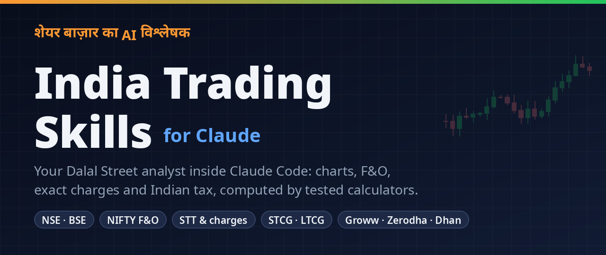

<div align="center">



# India Trading Skills — Claude के लिए शेयर बाज़ार विश्लेषक

**Claude को एक ऐसा Dalal Street analyst बनाइए जो हिसाब सही लगाए।**

29 skills · 16 tested calculators · NSE/BSE · NIFTY F&O · सटीक STT और charges · भारतीय टैक्स · Groww / Zerodha / Dhan / Upstox

[English README](README.md)

</div>

---

ज़्यादातर AI chatbots भारतीय बाज़ार के बारे में पूरे भरोसे से पुराने आँकड़े बता देते हैं: पिछले साल का
STT, पुराना NIFTY lot size, गलत दिन की expiry, और टैक्स set-off के ऐसे नियम जो हैं ही नहीं।

**India Trading Skills** Claude को NSE और BSE के 2026 के नियम सिखाता है, और हर हिसाब tested
calculators से करवाता है। कुछ बातें जो ज़्यादातर tools गलत बताते हैं:

- 💸 Delivery trade में breakeven तक पहुँचने का खर्च **लगभग 0.23%** है, "0.1%" नहीं।
- 📉 अप्रैल 2026 की STT बढ़ोतरी के बाद NIFTY futures के एक lot को सिर्फ़ charges निकालने के लिए **लगभग 14 points** चाहिए।
- 📅 NIFTY weekly expiry **मंगलवार** को होती है, लेकिन 2026 में छह मंगलवार छुट्टी थे। Expiry calendar इन्हें अपने-आप पिछले trading day पर ले जाता है।
- 🧾 F&O loss आपके capital gains से set off हो सकता है, लेकिन **salary से कभी नहीं**, और carry forward तभी होगा जब return समय पर भरें।

## ⚡ शुरुआत कैसे करें

**1. Install करें** (Claude Code के अंदर):

```
/plugin marketplace add Shubhamkumartrichy/claude-trading-skills-india
/plugin install india-trading-skills@india-trading-skills
```

**2. (वैकल्पिक) अपना broker जोड़ें**, ताकि live data मिले:

```bash
claude mcp add --transport http groww https://mcp.groww.in/mcp
# फिर Claude Code में /mcp चलाकर login करें
```

**3. हिंदी, Hinglish या English में पूछें:**

```
RELIANCE का पूरा analysis करो। मेरे पास ₹1,620 के औसत भाव पर 300 शेयर हैं।
```

Broker नहीं जोड़ना? `pip install yfinance` कर लें, skills खुद NSE data ले आएँगी। बाकी किसी चीज़ के
लिए कोई Python package नहीं चाहिए।

## 💬 आप क्या पूछ सकते हैं

| आप पूछें | Claude करेगा |
|---|---|
| "HDFCBANK खरीदूँ, बेचूँ या रुकूँ?" | Weekly→daily trend, support/resistance, indicators, संभावनाओं के साथ scenarios, stop और target वाली action table |
| "₹8 लाख और 150 point stop के साथ NIFTY के कितने lot ले सकता हूँ?" | Charges सहित lot के हिसाब से sizing, margin की गुंजाइश, और जब एक lot भी ज़्यादा हो तो साफ़ "मत लो" |
| "Groww और Zerodha पर 200 INFY ₹1,480 पर खरीदकर ₹1,520 पर बेचने का खर्च?" | STT, exchange, SEBI, stamp duty, GST और DP charges, breakeven भाव, सबसे सस्ता broker |
| "इस मंगलवार की expiry के लिए NIFTY iron condor बनाओ" | India VIX से expected move, strikes, max loss, breakevens, profit की संभावना, Greeks |
| "₹2.4 लाख LTCG, ₹60 हज़ार STCG, ₹1.1 लाख F&O loss, ₹18 लाख salary — टैक्स कितना?" | New regime का अनुमान, set-off के कदम, ₹1.25 लाख की छूट, 87A नियम, कौन-सा ITR, carry forward |
| "Option chain पढ़ो: PCR, max pain, OI walls?" | NSE की CSV से PCR, max pain, OI walls, नई writing, straddle range, IV skew |
| "Market खुलने से पहले की रिपोर्ट दो" | GIFT Nifty, FII/DII flows, India VIX, NIFTY के अहम स्तर, ban list, आज के events |
| "इस IPO में apply करूँ?" | RHP checklist, peers से valuation, subscription का मतलब, allotment की संभावना, lock-in तारीखें |

## 🧩 29 skills एक नज़र में

| समूह | Skills |
|---|---|
| **Analyst** | `india-market-analyst` (पूरा विश्लेषण), `market-pulse` (बाज़ार का हाल) |
| **Market timing** | `market-regime` (बाज़ार का trend और कितना निवेश करें), `sector-rotation` (कौन-से sector आगे हैं), `market-breadth` (rally कितनी चौड़ी है), `fii-dii-flows` (FII/DII पैसा और positioning) |
| **Charts** | `technical-analysis`, `multi-timeframe-analysis`, `rsi-divergence`, `fibonacci-trading`, `breakout-planner` (VCP breakout), `momentum-scanner` (momentum और gap-up stocks) |
| **Risk** | `position-sizing`, `stop-loss-strategies`, `trailing-stops`, `risk-reward-ratio`, `trading-discipline` (loss limit और checklist), `portfolio-review` (portfolio जाँच) |
| **Derivatives** | `fno-options-analysis`, `options-strategies`, `pair-trading` (futures से pair trade) |
| **भारत की ज़रूरी बातें** | `trading-costs` (charges), `indian-tax-for-traders` (टैक्स), `indian-market-structure` (नियम और समय), `broker-integration` |
| **Research** | `fundamental-screening`, `ipo-analysis`, `results-season` (results पर शेयर की प्रतिक्रिया), `backtest-lab` (strategy की backtesting) |

हर skill का पूरा विवरण [English README](README.md#skills) में है।

## 🛡️ सुरक्षा

- **बिना पूछे कोई order नहीं।** हर order से पहले Claude पूरा order ticket दिखाता है और आपकी साफ़ "हाँ" का इंतज़ार करता है।
- **हर आँकड़े का स्रोत और समय।** Live, delayed या end-of-day, सब साफ़ लिखा रहता है।
- **जोखिम पर ईमानदारी।** SEBI के अनुसार FY25 में लगभग 91% individual F&O traders को नुकसान हुआ। Beginners को defined-risk trades की सलाह दी जाती है।
- **सलाह नहीं।** यह शैक्षिक विश्लेषण है, SEBI-registered सलाह नहीं। टैक्स के जवाब हमेशा "CA से पुष्टि करें" पर खत्म होते हैं।

## 🤝 योगदान

STT, lot size, छुट्टियाँ और broker charges हर कुछ महीनों में बदलते हैं। आधिकारिक स्रोत के link के साथ
किया गया update सबसे कीमती योगदान है। [CONTRIBUTING.md](CONTRIBUTING.md) देखें।

अगर इससे आपका कोई गलत trade या गलत टैक्स अनुमान बचा, तो ⭐ star देकर दूसरे traders तक पहुँचाने में मदद करें।

## ⚠️ अस्वीकरण

ये skills बाज़ार विश्लेषण के शैक्षिक उपकरण हैं। ये निवेश, trading या टैक्स सलाह नहीं हैं, और किसी
SEBI-registered investment adviser या research analyst की ओर से नहीं हैं। Trading में भारी नुकसान का
जोखिम है। कोई भी कदम उठाने से पहले अपने broker, exchanges और Chartered Accountant से दरें और नियम जाँच लें।

## License

All skills and reference materials in this repository are provided for educational and research purposes.
