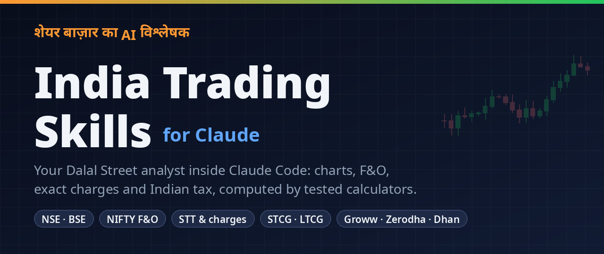
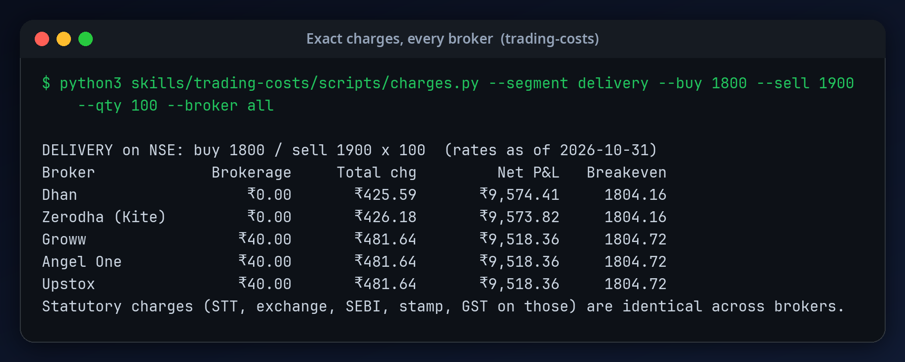
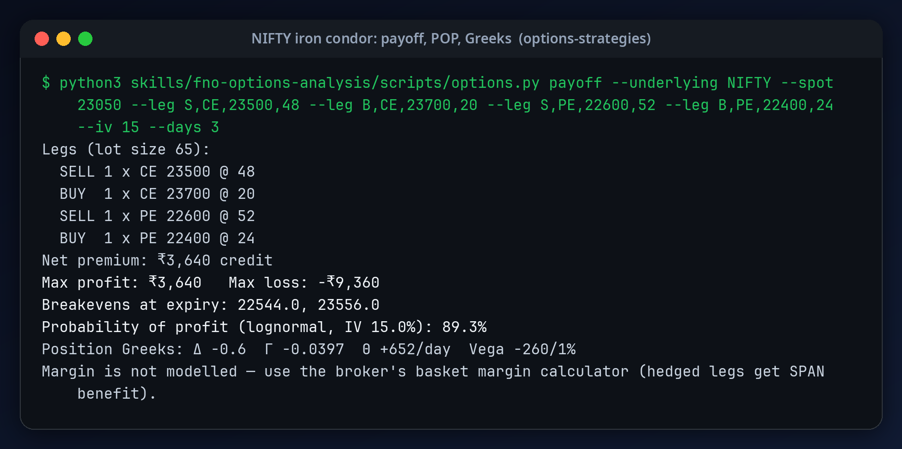
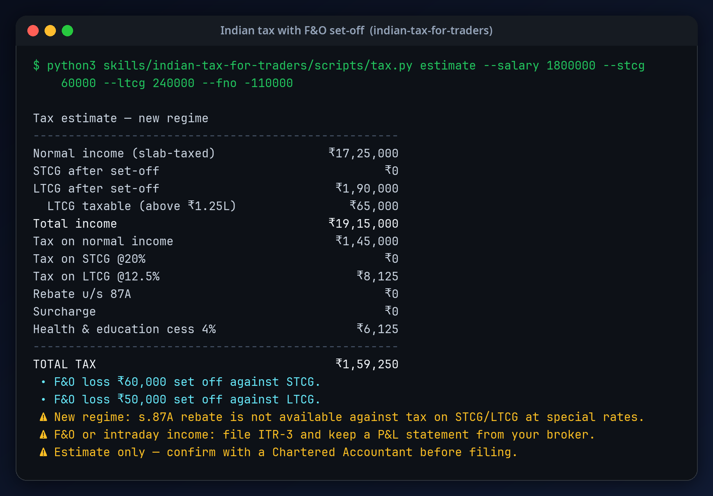
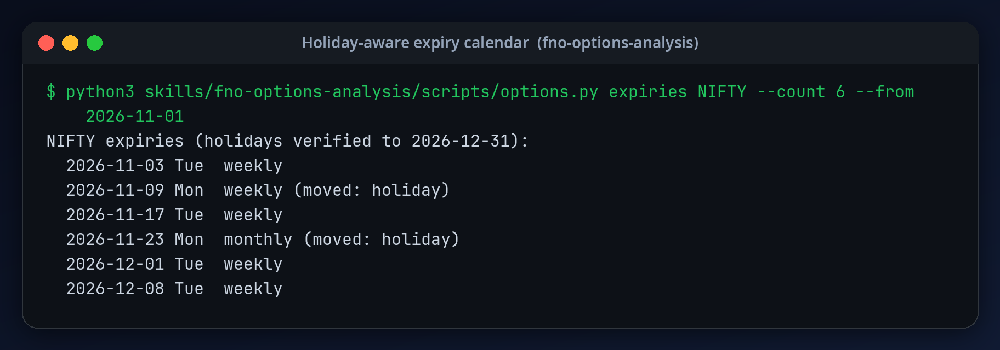
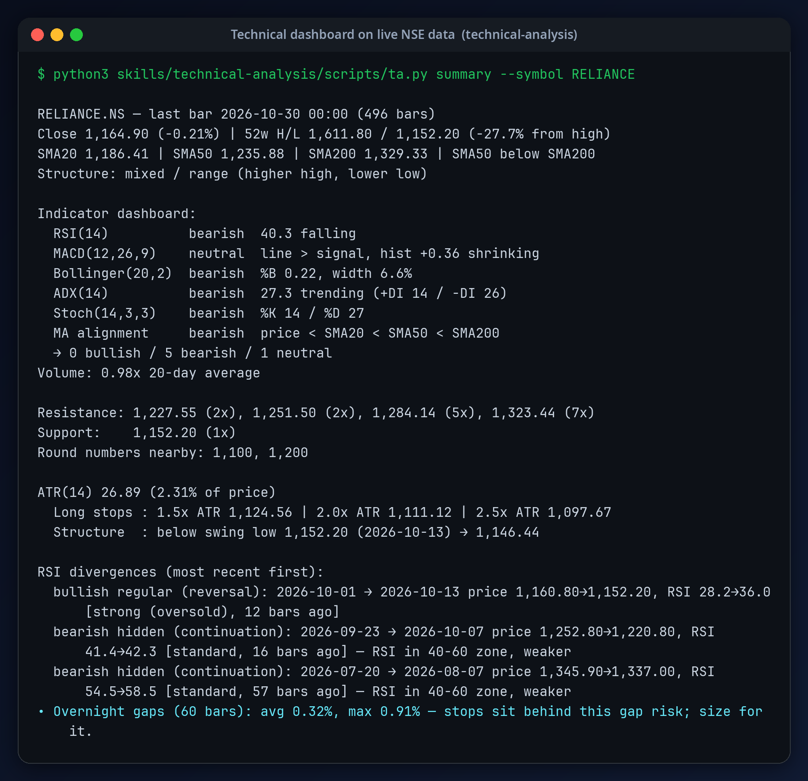

<div align="center">



# India Trading Skills for Claude

**Turn Claude into a Dalal Street analyst that gets the maths right.**

35 skills · 22 tested calculators · NSE/BSE · NIFTY F&O · exact STT & charges · Indian tax · Groww / Zerodha / Dhan / Upstox

[](#quick-start)
[](#skills)
[](https://github.com/Shubhamkumartrichy/claude-trading-skills-india/actions/workflows/tests.yml)
[](#calculators)
[](#calculators)
[](LICENSE)
[](#)

[Quick start](#quick-start) · [What you can ask](#what-you-can-ask) · [See it work](#see-it-work) · [Skills](#skills) · [Brokers](#brokers) · [FAQ](#faq) · [हिंदी में पढ़ें](README.hi.md)

</div>

---

Ask a chatbot about Indian markets and you get confident arithmetic with stale numbers: last year's
STT, the old NIFTY lot size, an expiry on the wrong weekday, and tax set-off rules that don't exist.

**India Trading Skills** gives Claude the 2026 rulebook for NSE and BSE, plus calculators that do the
maths instead of guessing. Some of what it knows that most tools get wrong:

- 💸 A delivery round trip costs **about 0.23%** to break even, not the "~0.1%" most guides quote.
- 📉 After the April 2026 STT hike, a NIFTY futures lot needs **about 14 points** just to cover charges.
- 📅 NIFTY weeklies expire on **Tuesday**, but 2026 had six Tuesday holidays. The expiry calendar shifts them for you.
- 🧾 An F&O loss can offset your capital gains but **never your salary**, and only if you file on time.

<p align="center">
  
</p>

> Works in **Claude Code** as a plugin. The skills use the standard `SKILL.md` format, so any agent
> that supports Agent Skills can load them.

<a id="quick-start"></a>

## ⚡ Quick start

**1. Install** (inside Claude Code):

```
/plugin marketplace add Shubhamkumartrichy/claude-trading-skills-india
/plugin install india-trading-skills@india-trading-skills
```

**2. Optionally connect your broker** for live data:

```bash
claude mcp add --transport http groww https://mcp.groww.in/mcp
# then run /mcp inside Claude Code and log in
```

**3. Ask in plain English (or Hinglish):**

```
Analyze HDFCBANK. I hold 300 shares at ₹1,620 since March 2026.
```

No broker? Run `pip install yfinance` and the skills fetch NSE data themselves. No Python packages
are needed for anything else.

<details>
<summary><b>Other ways to install</b></summary>

**skills CLI**

```bash
npx skills add Shubhamkumartrichy/claude-trading-skills-india
```

**Manual (project-level symlinks)**

```bash
git clone https://github.com/Shubhamkumartrichy/claude-trading-skills-india.git
mkdir -p .claude/skills
for d in claude-trading-skills-india/skills/*/; do ln -s "$(cd "$d" && pwd)" ".claude/skills/$(basename "$d")"; done
```

Install the whole pack. Several skills call scripts that live in sibling skills (for example,
`rsi-divergence` uses `technical-analysis/scripts/ta.py`).

</details>

<a id="what-you-can-ask"></a>

## 💬 What you can ask

| You ask | Claude does |
|---|---|
| "Analyze RELIANCE. Buy, sell or wait?" | Weekly→daily view, levels, indicator dashboard, scenarios with odds, an action table with stops and targets |
| "How many NIFTY lots can I trade with ₹8 lakh and a 150-point stop?" | Lot-rounded sizing with costs, margin headroom, and a clear "skip it" when one lot is too big |
| "Charges to buy 200 INFY at 1,480 and sell at 1,520 on Groww vs Zerodha?" | Exact STT, exchange, SEBI, stamp, GST and DP charges, breakeven price, cheapest broker |
| "Build a NIFTY iron condor for Tuesday's expiry" | Expected move from India VIX, strikes beyond it, max loss, breakevens, probability of profit, Greeks |
| "Read this option chain: PCR, max pain, walls?" | Parses NSE's CSV download: PCR, max pain, OI walls, fresh writing, straddle range, IV skew |
| "₹2.4L LTCG, ₹60k STCG, ₹1.1L F&O loss, ₹18L salary. My tax?" | New-regime estimate with set-off steps, the ₹1.25L exemption, 87A rules, ITR form, carry-forward |
| "Which holdings should I sell before March for the LTCG exemption?" | Tax-harvesting plan from your holdings CSV, including lots that turn long-term soon |
| "Pre-market brief" | GIFT Nifty, FII/DII flows, India VIX, NIFTY levels, ban list, events, with a regime label |
| "Is NIFTY in a confirmed uptrend? How much should I deploy?" | Distribution days, follow-through status, risk score, exposure ceiling and max new positions |
| "Is POLYCAB setting up for a breakout?" | Stage 2 checklist, VCP contractions, pivot, and a GTT order plan sized to your risk |
| "Review my portfolio" | Stock, sector and group concentration, LTCG countdown, beta, drawdown, tax-aware rebalance |
| "Are FIIs buying or selling? What's the FII long/short ratio?" | Flow streaks, DII absorption, FII index-futures long % from NSE's participant OI file, extremes flagged |
| "Backtest a 20/50 SMA cross on RELIANCE with Zerodha charges" | Next-bar fills, exact charges, CAGR vs buy-and-hold, drawdown, walk-forward and Monte Carlo checks |
| "Is HDFCBANK vs ICICIBANK a tradable pair?" | Cointegration test, hedge ratio, half-life, z-score, and a whole-lot futures plan |
| "Any RBI, Fed or CPI events before my trade? When's the next expiry?" | Holiday-adjusted expiries, verified RBI/FOMC dates, results windows, a yes/no event-risk answer |
| "Is the market expensive right now?" | NIFTY P/E percentile, yield gap vs G-sec, market cap to GDP, froth score and posture |
| "Find quality compounders in my Screener.in export" | Preset screens with every rule shown, near-misses, pledge and small-cap gates |
| "Should I apply for this IPO?" | RHP checklist, valuation vs peers, subscription reading, allotment odds, lock-in dates |
| "Where do I put my stop, GTT or SL?" | Structure/ATR stop plus Indian execution realities: DAY validity, GTT limits, circuits, gaps |

<a id="see-it-work"></a>

## 🖥️ See it work

Real output from the bundled calculators. The RELIANCE dashboard uses NSE data from 30 Oct 2026.

<table>
<tr>
<td width="50%"></td>
<td width="50%"></td>
</tr>
<tr>
<td width="50%"></td>
<td width="50%"></td>
</tr>
</table>

<details>
<summary><b>Technical dashboard on live NSE data (RELIANCE)</b></summary>
<br>

</details>

<a id="skills"></a>

## 🧩 The 35 skills

| Group | Skill | What it does |
|---|---|---|
| **Analyst** | `india-market-analyst` | Orchestrator: full analysis, routing, ground rules, output template |
| | `market-pulse` | Pre-market and post-market brief: GIFT Nifty, FII/DII, VIX, breadth, sectors, regime |
| **Market timing** | `market-regime` | NIFTY distribution days, follow-through days, top-risk score, exposure ceiling |
| | `sector-rotation` | NSE sectoral indices vs NIFTY: relative strength, RRG quadrants, risk-on vs defensive tilt |
| | `market-breadth` | % of stocks above 20/50/200 DMA, A/D line, new highs/lows, McClellan, breadth thrust, 0–100 health score |
| | `fii-dii-flows` | FII/DII cash-flow streaks, FII index-futures long/short from NSE participant OI, shareholding changes, bulk/block deals |
| | `macro-regime` | 6–24 month backdrop: crude, rupee, G-sec yields and curve, smallcap vs NIFTY, equity vs gold |
| | `market-valuation` | NIFTY P/E and P/B percentiles, yield gap, market cap to GDP, 0–100 froth score |
| | `event-calendar` | Expiries, holidays, RBI/FOMC/CPI dates, tax dates, results windows, .ics export |
| **Charts** | `technical-analysis` | Trend, S/R clusters, gaps, indicator dashboard, ATR stops, circuit and gap checks |
| | `multi-timeframe-analysis` | Weekly → daily → 75-minute screens with a 6-point confluence score |
| | `rsi-divergence` | Regular and hidden divergences, found automatically, with trading rules |
| | `fibonacci-trading` | Auto-swing retracements and trend-based extensions, confluence ladder |
| | `momentum-scanner` | 4% momentum bursts, episodic-pivot gaps on 3× volume, 1–99 RS rating, circuit and liquidity filters |
| | `exhaustion-reversal` | Parabolic-top score, scale-out plans, F&O-only shorts, washout bottoms, news-reaction failures |
| | `breakout-planner` | Stage 2 trend template, VCP and flat bases, pivot, GTT breakout plan with circuit-band checks |
| **Risk** | `position-sizing` | Fixed-fractional with costs, F&O lots, leverage, gap risk, Kelly, journal stats |
| | `stop-loss-strategies` | Where to put the stop, and how GTT, SL and SL-M really behave in India |
| | `trailing-stops` | R-multiple ladder, ATR, structure and chandelier trails |
| | `risk-reward-ratio` | R after costs, scale-outs, breakeven win rate, expectancy |
| | `trading-discipline` | Daily/weekly loss circuit breaker, pre-trade checklist, performance review by setup |
| | `portfolio-review` | Concentration, sector and market-cap mix, LTCG countdown, beta, drawdown, tax-aware rebalance |
| | `thesis-tracker` | Trade-idea lifecycle with kill criteria, review dates, post-mortems, LTCG countdown, journal export |
| **Derivatives** | `fno-options-analysis` | Option chains, PCR, max pain, VIX, IV, Greeks, expiries, OI buildup, SEBI F&O rules |
| | `options-strategies` | Strategy matrix by view and volatility, expiry-day dynamics, management, events |
| | `pair-trading` | Engle–Granger cointegration, half-life, z-score signals, lot-rounded stock-futures execution |
| **India essentials** | `trading-costs` | STT, exchange, SEBI, stamp, GST and DP charges for 5 brokers, breakevens, MTF |
| | `indian-tax-for-traders` | STCG/LTCG, F&O and intraday income, set-off, ITR, harvesting, Income-tax Act 2025 |
| | `indian-market-structure` | Sessions, closing VWAP, T+1, order types, circuits, ASM/GSM, F&O ban, holidays |
| | `broker-integration` | Groww, Kite, Dhan, Upstox, Fyers and Kotak MCPs, plus an order-safety protocol |
| **Research** | `fundamental-screening` | Screener-style quality, valuation, shareholding and governance red flags |
| | `ipo-analysis` | RHP checklist, subscription reading, allotment odds, GMP caveats, lock-ins |
| | `results-season` | Results-day reaction score (A–D), post-results drift, results inside your holding window |
| | `backtest-lab` | Backtests with exact Indian charges, next-bar fills, parameter sweeps, walk-forward, Monte Carlo |
| | `stock-screener` | CANSLIM-India, value-dividend, GARP and quality screens on a Screener.in export, pledge gate |

<a id="calculators"></a>

## 🧮 Calculators

Twenty-two standard-library Python engines (Python 3.10+, no installs). Claude runs them, and you can too:

```bash
# Charges and breakeven: zerodha | groww | angelone | upstox | dhan | all
python3 skills/trading-costs/scripts/charges.py --segment intraday --buy 2450 --sell 2465 --qty 200 --broker all

# Technical dashboard / multi-timeframe / divergences / Fibonacci (yfinance, CSV, or broker candles)
python3 skills/technical-analysis/scripts/ta.py summary --symbol RELIANCE
python3 skills/technical-analysis/scripts/ta.py mtf --symbol NIFTY

# Options: expiries, Greeks, IV, option chain, multi-leg payoff
python3 skills/fno-options-analysis/scripts/options.py expiries NIFTY
python3 skills/fno-options-analysis/scripts/options.py chain examples/sample_option_chain.csv --spot 23050

# Sizing, R:R, trailing stops, journal stats
python3 skills/position-sizing/scripts/risk.py size --capital 500000 --risk-pct 1 --entry 1450 --stop 1410 --cap midcap

# Tax: estimate, tradebook FIFO, turnover, harvesting
python3 skills/indian-tax-for-traders/scripts/tax.py estimate --salary 1800000 --stcg 60000 --ltcg 240000 --fno -110000

# Market regime and sector rotation
python3 skills/market-regime/scripts/regime.py status --symbol NIFTY --vix 14.2
python3 skills/sector-rotation/scripts/sectors.py rotation

# Breakout setups, trading discipline, portfolio review
python3 skills/breakout-planner/scripts/breakout.py check --symbol POLYCAB --benchmark NIFTY
python3 skills/trading-discipline/scripts/discipline.py breaker examples/sample_journal.csv --capital 500000
python3 skills/portfolio-review/scripts/portfolio.py review examples/sample_holdings.csv --cash 200000

# Breadth, FII/DII positioning, momentum and results reactions
python3 skills/market-breadth/scripts/breadth.py status --universe-file nifty500.csv
python3 skills/fii-dii-flows/scripts/flows.py participants --oi participant_oi/
python3 skills/momentum-scanner/scripts/momentum.py scan --symbols TATAMOTORS,TRENT,POLYCAB,DIXON --benchmark NIFTY
python3 skills/results-season/scripts/results.py score --symbol INFY --date 2026-10-16 --timing post-market

# Pairs and backtests
python3 skills/pair-trading/scripts/pairs.py test HDFCBANK ICICIBANK
python3 skills/backtest-lab/scripts/backtest.py run --symbol RELIANCE --strategy sma-cross --params fast=20 slow=50 --broker zerodha

# Screens, macro, valuation, calendar, exhaustion, thesis memory
python3 skills/stock-screener/scripts/screen.py run --csv screener_export.csv --preset quality-compounder
python3 skills/macro-regime/scripts/macro.py status --csv-dir macro_data/
python3 skills/market-valuation/scripts/valuation.py pe --csv nifty50_pe.csv
python3 skills/event-calendar/scripts/events.py week
python3 skills/exhaustion-reversal/scripts/exhaustion.py climax --symbol KAYNES
python3 skills/thesis-tracker/scripts/thesis.py --store ~/trading/theses.json due
```

**Trust but verify:** the 560 unit tests pin hand-checked numbers, and the indicators match the
`ta` library to 13 significant digits. Run `python3 -m unittest discover -s tests`. Sample data is in
[examples/](examples/).

<a id="brokers"></a>

## 🔌 Connect your broker

| Broker | MCP endpoint | Orders | Notes |
|---|---|---|---|
| **Groww** | `https://mcp.groww.in/mcp` | ✅ buy, limit, SL | Sells need DDPI; daily login |
| **Zerodha Kite** | `https://mcp.kite.trade/mcp` | GTT only (hosted) | Full tools if you self-host the open-source server |
| **Dhan** | `https://mcp.dhan.co/mcp` | ✅ incl. Super Orders | Live quotes and chain need the Data API |
| **Upstox** | `https://mcp.upstox.com/mcp` | ❌ read-only | Separate Upstox skill can trade |
| **Fyers** | `https://mcp.fyers.in/mcp` | ❌ | Alerts and watchlists |
| **Kotak Neo** | `https://neo.kotaksecurities.com/mcp-server/mcp` | ❌ | Desktop apps, QR login |

```bash
claude mcp add --transport http kite https://mcp.kite.trade/mcp
```

Checked October 2026. Brokers change capabilities often, so Claude lists the connected tools before
using them.

<a id="safety"></a>

## 🛡️ Safe by design

- **No surprise orders.** Claude shows a full order ticket (symbol, side, quantity, product, limit price,
  charges, margin) and waits for your explicit "yes" before every order. It never runs orders from
  loops or schedules, in line with SEBI's 2026 retail-algo rules.
- **Every number is sourced and timestamped.** Prices are labelled live, delayed or end-of-day, and
  stale data triggers a warning.
- **Honest about risk.** It cites SEBI's finding that about 91% of individual F&O traders lost money
  in FY25, and steers beginners toward defined-risk trades.
- **Not advice.** The skills give educational analysis, not SEBI-registered advice, and tax answers
  end with "confirm with a CA".

<a id="india-facts"></a>

## 🇮🇳 India facts baked in

<details>
<summary><b>Rates and rules verified on 31 Oct 2026</b></summary>

| Item | Value |
|---|---|
| STT | Delivery 0.1% both sides; intraday 0.025% sell; futures **0.05%** sell; options **0.15%** of premium sell (F&O raised from 1 Apr 2026) |
| NSE transaction charges | Equity 0.00307%, futures 0.00183%, options 0.03553% of premium (from 1 Mar 2026) |
| Stamp duty (buy side) | Delivery 0.015%, intraday 0.003%, futures 0.002%, options 0.003% |
| Index lot sizes | NIFTY 65, BANKNIFTY 30, FINNIFTY 60, MIDCPNIFTY 120, NIFTYNXT50 25, SENSEX 20, BANKEX 30 |
| Weekly expiries | NIFTY Tuesday (NSE), SENSEX Thursday (BSE); holidays move expiry to the previous trading day |
| Capital gains | STCG 20%; LTCG 12.5% above ₹1.25 lakh; listed equity is long-term after 12 months |
| New-regime slabs | 0/5/10/15/20/25/30% at ₹4/8/12/16/20/24 lakh; zero tax up to ₹12 lakh (not on special-rate gains) |
| Settlement | T+1, with optional T+0 for up to 500 stocks |
| API orders | SEBI retail algo framework in force from 1 Apr 2026 (registered apps, static IP) |

A monthly GitHub Action flags these when they are more than 120 days old. See
[CONTRIBUTING.md](CONTRIBUTING.md#updating-rates-and-rules) to update them.

</details>

<a id="faq"></a>

## ❓ FAQ

<details><summary><b>Is this financial advice?</b></summary>

No. It is an educational analysis toolkit. It shows its working, cites data, and gives scenarios
rather than tips. You make the decisions.
</details>

<details><summary><b>Will it place trades on my account?</b></summary>

Only if you connect an order-capable broker (Groww, Dhan) **and** confirm each order ticket
explicitly. Analysis never triggers orders. Zerodha's hosted MCP can only create GTT orders.
</details>

<details><summary><b>Do I need a paid API or data subscription?</b></summary>

No. Without a broker, the skills use yfinance (free, end-of-day quality) or CSVs you provide.
Zerodha and Upstox say their MCPs are free, and Groww lists no fee. Dhan charges for live quotes and
option chains.
</details>

<details><summary><b>Is my broker login safe?</b></summary>

Broker MCPs use OAuth or a broker login page, so Claude never sees your password. The skills never
ask you to paste API secrets into chat. Prefer read-only connections if you only want analysis.
</details>

<details><summary><b>How current are the numbers?</b></summary>

Everything was verified on 31 Oct 2026 from broker pricing pages, exchange circulars and news
coverage. Rates live in a few constants, and the data-update issue template makes fixing them a
two-minute contribution.
</details>

<details><summary><b>Can I use it in Hindi?</b></summary>

Yes. Ask in Hindi or Hinglish ("RELIANCE ka analysis karo", "मेरे F&O loss पर टैक्स कितना लगेगा?").
A Hindi README is [here](README.hi.md).
</details>

<a id="roadmap"></a>

## 🗺️ Roadmap

- [ ] MCX commodities (crude, gold) and currency derivatives
- [ ] Mutual funds and SIP analysis (XIRR, overlap, expense ratios)
- [ ] NSE bhavcopy and delivery-% loader
- [ ] Screener.in fundamentals fetcher
- [ ] More broker profiles in the charges calculator (ICICI Direct, Kotak, HDFC Sky, Fyers)

Have an idea? [Open a skill request](../../issues/new/choose).

<a id="contributing"></a>

## 🤝 Contributing

Pull requests are welcome, especially **rate and rule updates**. Indian market parameters change
every few months, and a fix with an official source link is the most valuable contribution there is.
See [CONTRIBUTING.md](CONTRIBUTING.md).

## ⭐ Star history

If this saved you from a bad trade or a wrong tax estimate, a star helps other traders find it.

<a href="https://www.star-history.com/?repos=Shubhamkumartrichy%2Fclaude-trading-skills-india&type=date&legend=bottom-right">
  <picture>
    <source media="(prefers-color-scheme: dark)" srcset="https://api.star-history.com/chart?repos=Shubhamkumartrichy/claude-trading-skills-india&type=date&theme=dark&legend=bottom-right" />
    <source media="(prefers-color-scheme: light)" srcset="https://api.star-history.com/chart?repos=Shubhamkumartrichy/claude-trading-skills-india&type=date&legend=bottom-right" />
    
  </picture>
</a>

## ⚠️ Disclaimer

These skills are educational tools for market analysis. They are not investment, trading or tax
advice, and they do not come from a SEBI-registered investment adviser or research analyst. SEBI
found that about 91% of individual F&O traders lost money in FY25. Trading involves substantial risk
of loss. Verify rates and rules with your broker, the exchanges and a Chartered Accountant before
acting.

## License

All skills and reference materials in this repository are provided for educational and research purposes.
